<p align="center">
  
</p>

<p align="center">
  <a href="pyproject.toml"></a>
  <a href="docs/alternatives.md"></a>
  <a href="docs/data-model.md"></a>
  <a href="LICENSE"></a>
</p>

<p align="center">
  <a href="#keep"><b>Keep</b></a> &nbsp;·&nbsp;
  <a href="#find"><b>Find</b></a> &nbsp;·&nbsp;
  <a href="#rewire"><b>Rewire</b></a> &nbsp;·&nbsp;
  <a href="#evolve"><b>Evolve</b></a> &nbsp;·&nbsp;
  <a href="#quickstart"><b>Quickstart</b></a> &nbsp;·&nbsp;
  <a href="#docs"><b>Docs</b></a>
</p>

<br>

**engram** files what you tell [Claude Code](https://claude.com/claude-code) as Markdown in your own git repos, one per area of your life, and hands Claude the whole story when you ask, in about half the tokens of Claude grepping the files itself ([measured](docs/evaluation.md#against-grep): one record, 74 questions).

- **[Keep](#keep):** talk as usual → each hour engram files the facts. Only in your words and numbers; a date you never gave narrows to the month you did.
- **[Find](#find):** ask → one call returns the match, what links to it, in time order. Fix a fact → both versions kept, returned as one result.
- **[Rewire](#rewire):** [bring your notes](#bring-your-notes), searched as they stand; rewire a copy for stories, timelines and filing, and nothing lands until you've seen the pages.
- **[Evolve](#evolve):** opt in → a weekly pass tunes each repo to how you use it. Undoable changes land; bigger ones wait for you.

Runs where Claude Code runs on your own machine: macOS, Linux, WSL2. Readable without engram; pushed only if you turn it on.

<p align="center">
  <picture>
    <source media="(prefers-color-scheme: dark)" srcset="docs/assets/loop-dark.svg">
    <source media="(prefers-color-scheme: light)" srcset="docs/assets/loop-light.svg">
    
  </picture>
</p>

## Keep

Just talk to Claude Code. Every hour, engram reads your finished sessions and files the facts worth keeping. Most sessions file nothing.

Claude, through your own Claude Code, proposes facts; code decides what gets in:

| Proposed fact | What happens |
|---|---|
| Quote, numbers included, isn't in your own words | dropped |
| Has a day you never said | narrowed to the month or year you did say |
| Already in the record | dropped as a repeat |
| Passes all three | filed as an entry and committed; pushed, if the repo pushes, to its own remote |

<p align="center">
  <picture>
    <source media="(prefers-color-scheme: dark)" srcset="docs/assets/filer-dark.svg">
    <source media="(prefers-color-scheme: light)" srcset="docs/assets/filer-light.svg">
    
  </picture>
</p>

How the filer checks each fact: [technical](docs/technical.md#the-filer).

**Hand it over instead:** a link, a video, a screenshot or a scribble is kept as saved (`engram source add`) and compiled into a wiki of concept articles you read in Obsidian: what each concept means in your thinking, what the sources say in their own words, the case against, and where your own posts use it, linked whole. Claude keeps it; code checks every quote against its source ([data model](docs/data-model.md#sources-sparks-and-the-wiki)).

## Find

You ask; Claude runs the command, one call per question (`engram setup` allows it; no MCP server). For a whole history:

```
$ uv run engram timeline "what happened with the north bed this season?" --domain notes

{"chain":"north-bed","kind":"story","records":6,"from":"2026-04-12","to":"2026-10-12", …}
n  date        on            who  kind         what                                                          id      versions
1  2026-04-12  north-bed     me   planting     planting › Six tomato plants in the north bed                 p8qdad
2  2026-06     basil         me   observation  observation › Basil bolted in late June, before the heatwave  sk4rve  2026-07 me: corrected: July → late June [vmjm82]
3  2026-09-28  north-bed     me   harvest      harvest › About 3 kg of Sungold picked this week              rrwajk
4  2026-10-12  frost         me   observation  First frost on the north bed                                  vkwkq2
5              search match                    The beds › North bed                                          7nsjw2
6              search match                    The beds                                                      33pj7d
```

<sub>From the example garden in this repo; header shortened.</sub>

Corrections never erase. Fix a fact → engram keeps both and links them, and you get them back as one result: the current version in full, older ones on one line (row 2: `corrected: July → late June`).

<p align="center">
  <picture>
    <source media="(prefers-color-scheme: dark)" srcset="docs/assets/versions-dark.svg">
    <source media="(prefers-color-scheme: light)" srcset="docs/assets/versions-light.svg">
    
  </picture>
</p>

| Command | You get |
|---|---|
| `engram timeline "<question>"` | the threads it touches, every row in time order, corrections beside each fact |
| `engram search "<question>"` | ranked matches, tuned by the repo's own weights |
| `engram show <id>` | one record, by an id search or timeline printed |

Each repo searches only itself unless you ask. More in [search](docs/search.md#the-one-call-timeline).

## Rewire

Rewiring shapes a repo around what you use it for, on a scratch copy; nothing lands until you've seen your pages before and after:

your own words → your jobs → the kinds of question each job brings → the part of the record that answers each

<p align="center">
  <picture>
    <source media="(prefers-color-scheme: dark)" srcset="docs/assets/rewire-dark.svg">
    <source media="(prefers-color-scheme: light)" srcset="docs/assets/rewire-light.svg">
    
  </picture>
</p>

- Saved as `[rewire]` in the repo's `.engram/engram.toml`
- Drift from it → the repo's pre-commit refuses; `engram health` shows it
- Claude runs it with the `engram-rewire` skill; link it in once:

```bash
ln -s "$PWD/skills/engram-rewire" ~/.claude/skills/
```

More in [shape](docs/shape.md#rewiring-a-repo).

### Bring your notes

Any folder of Markdown, text or CSV, in git or not: full-text search by section, as it stands. engram never writes to it. Add it to your config ([Quickstart](#quickstart)).

- **An Obsidian vault:** read by its own structure, nothing in it changed. Tags become threads you get as a timeline, daily notes date what's in them, naming a note brings its backlinks, and a note whose properties say `supersedes: "[[Old note]]"` comes back with the old one folded under it. To read its tags, properties and folders your way, ask Claude for the short interview in the `engram-rewire` skill; its result stays in engram's config folder. Without git there's no "as it stood" ([shape](docs/shape.md#a-vault-read-as-it-stands))
- **For stories, timelines, corrections and filing:** rewire a git copy of it
- **Your own tool, with its own store:** write a [pack](docs/shape.md#a-pack) that reads it; engram never files there. `summaries = true` in its `[domains.<name>]` keeps what you said about it findable too, at model cost; on a box with no repo set up, `engram capture install` adds the hourly job that does it
- **Not yet:** no importer for Apple Notes, Keep or spreadsheets, so export to Markdown or CSV

## Evolve

Off until `engram refine install`. Then every week `engram refine` tunes engram and each repo against that repo's jobs, capped by default at $100 a week of Claude Code's reported cost (`[refine] weekly_cap`). A change lands by itself only if one revert undoes it, nothing in your record is lost, it leaves how your record gets written alone, and a fresh reviewer passes it; anything bigger, or dropping something you asked for, waits for your yes.

<p align="center">
  <picture>
    <source media="(prefers-color-scheme: dark)" srcset="docs/assets/evolve-dark.svg">
    <source media="(prefers-color-scheme: light)" srcset="docs/assets/evolve-light.svg">
    
  </picture>
</p>

More in [the example's rules](examples/notes/.engram/README.md#lands-on-its-own-only-if-all-of-these-hold).

## Where things live

<p align="center">
  <picture>
    <source media="(prefers-color-scheme: dark)" srcset="docs/assets/record-dark.svg">
    <source media="(prefers-color-scheme: light)" srcset="docs/assets/record-light.svg">
    
  </picture>
</p>

<p align="center">
  <picture>
    <source media="(prefers-color-scheme: dark)" srcset="docs/assets/arch-dark.svg">
    <source media="(prefers-color-scheme: light)" srcset="docs/assets/arch-light.svg">
    
  </picture>
</p>

- **Your records:** your repos, plain files ([data model](docs/data-model.md)); pushed only if a repo sets `push = true`, to its own remote
- **`.engram/`:** engram's folder in each repo: its shape, your jobs and rules, and the pack, the repo's words for engram's model calls ([shape](docs/shape.md#a-pack), [example](examples/notes/.engram/))
- **The index:** `~/.local/share/engram/`, rebuilt from your files plus the session summaries kept there; a lost summary is made again from the session files or their mirror, at model cost
- **Model calls:** filing sends each finished session in a set-up repo through your own Claude Code (`claude -p`)

> **Not goals:** embeddings (unless [this rule](docs/evaluation.md#embeddings-the-rule) fires), breaking arguments into fragments, multiple users, a web UI.

## Quickstart

Needs git, Python 3.12+ and [uv](https://docs.astral.sh/uv/).

```sh
git clone https://github.com/rickdiculousli/engram.git && cd engram
uv sync
export ENGRAM_CONFIG=examples/config.toml ENGRAM_SESSIONS_ROOT=examples/sessions ENGRAM_DATA="$(mktemp -d)"
uv run engram ingest
uv run engram timeline "what happened with the north bed this season?" --domain notes
uv run engram search "when did the basil bolt" --domain notes
```

- `examples/config.toml`: the made-up garden's config, laid over yours for this shell only; your own is `~/.config/engram/config.toml`
- `ENGRAM_SESSIONS_ROOT`, `ENGRAM_DATA`: this shell reads only the garden's made-up Claude Code sessions, not every one on your machine, and keeps its index in a throwaway folder, not `~/.local/share/engram/`
- Your own notes, in a new shell: add `[domains.<name>]` with `repo = "<folder>"` to your config, then `uv run engram ingest` and `uv run engram search "<something you wrote>" --domain <name>`
- `uv tool install -e .` → `engram` on your PATH; inside a folder you added, drop `--domain`
- `engram setup <repo>` → hourly filing for a rewired repo, and lets Claude run engram there: launchd on macOS, systemd timers on Linux and WSL2 ([operations](docs/operations.md#jobs))

## Docs

**Start here:**
- [data model](docs/data-model.md): what's on disk: entries, documents, threads, links; the library, transactions, the pre-commit
- [search](docs/search.md): what gets indexed, sessions, and how one call returns a whole history, corrections included
- [alternatives](docs/alternatives.md): why SQLite FTS5, no embeddings, no graph database, with measurements

**Bringing a repo in:**
- [shape](docs/shape.md): the layout every record follows, how Claude calls engram, packs, rewiring
- [migration](docs/migration.md): how a repo changes shape: on a copy first, you see your pages before and after

**Running it:**
- [operations](docs/operations.md): where things live, the jobs, the archive, releases, health
- [summaries](docs/summaries.md): who-said-what rules, session and record summaries

**Why, and how it's measured:**
- [technical](docs/technical.md): the decision log, each call with its why
- [evaluation](docs/evaluation.md): how retrieval is measured, the results against grep, and the frozen gate

The README's art is generated: [docs/assets/gen](docs/assets/gen/README.md).

## License

MIT.

<br>

<p align="center"></p>
